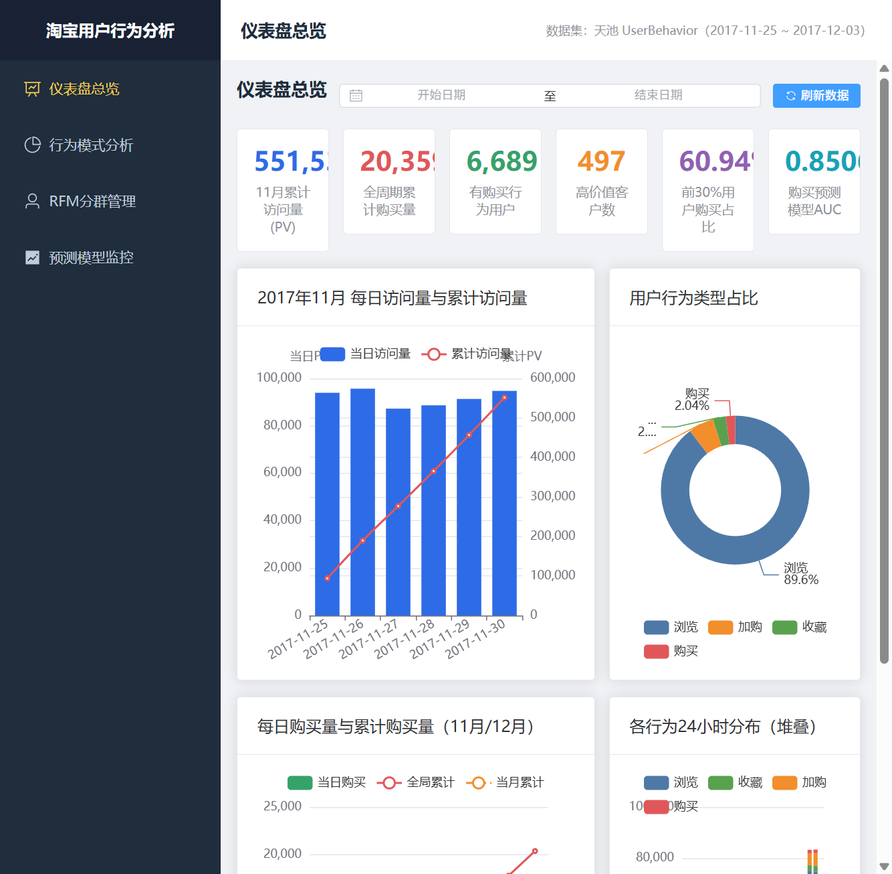
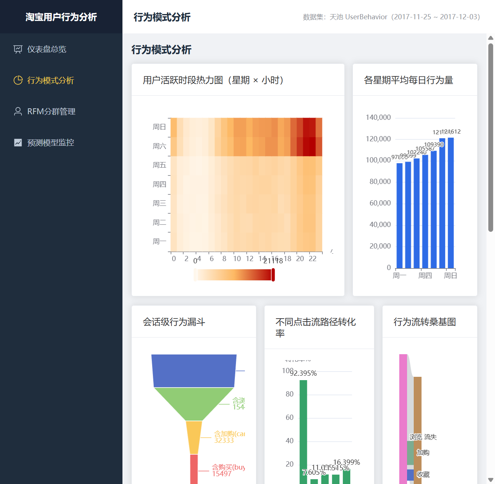
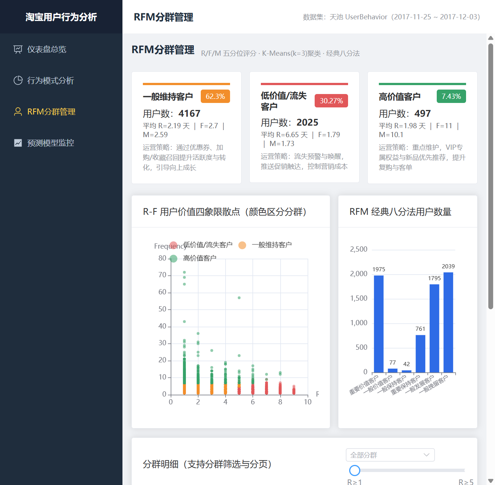
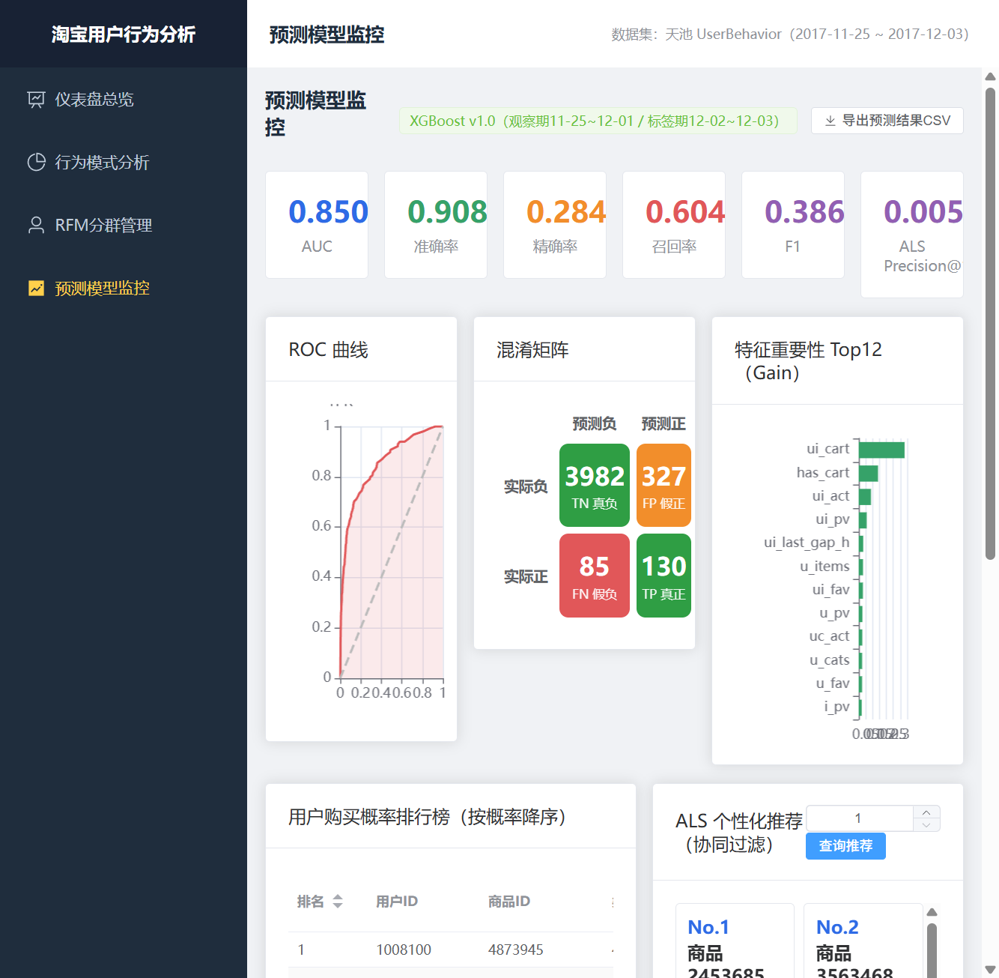
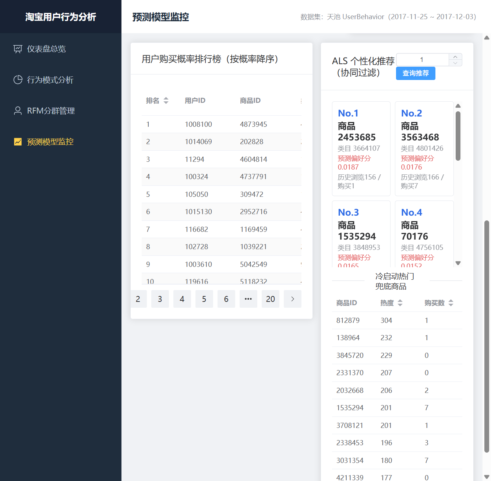
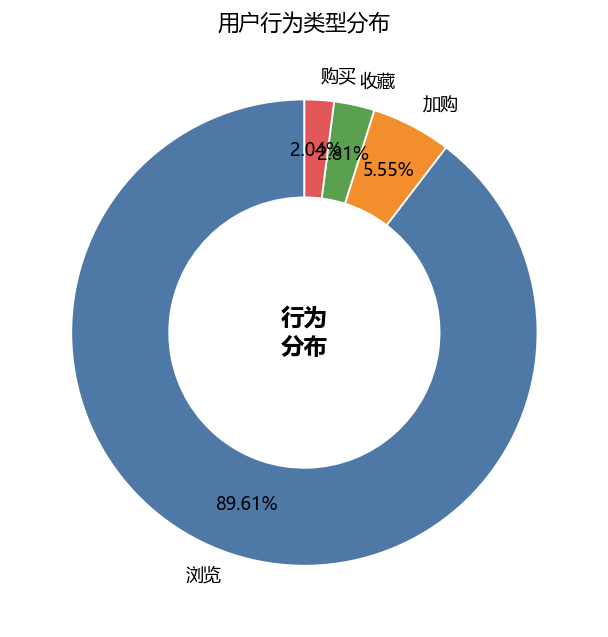
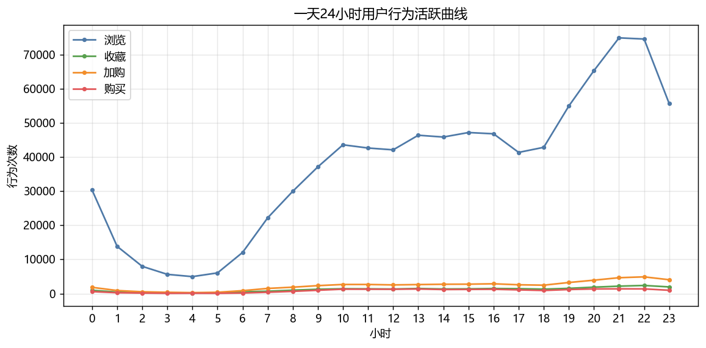
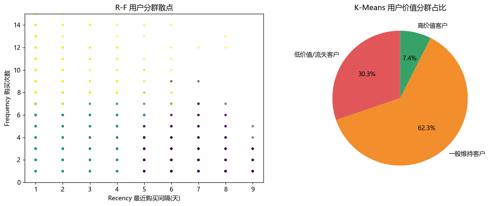

# 淘宝用户购物行为大数据分析系统

《行业工程实践》课程项目。基于天池 UserBehavior 数据集，用 **PySpark + 机器学习 + Spring Boot + Vue3** 搭了一条从原始日志到可视化决策的完整链路：数据清洗 → 行为统计 / 路径转化 / RFM 分层 / 购买意向预测 / 个性化推荐 → 结果入库 → REST API → 交互式前端。

**技术栈**：PySpark 3.5 · Spark MLlib · XGBoost · MySQL 8 · Spring Boot 3 · Vue 3 · ECharts · Element Plus · Maven · Vite

---

## 效果预览

| 系统总览 | 用户行为分析 |
| :---: | :---: |
|  |  |
| **RFM 客户分层** | **购买意向预测** |
|  |  |



<details>
<summary>展开查看分析图集（共 13 张）</summary>

| 行为构成 | 活跃时段曲线 | RFM 聚类 |
| :---: | :---: | :---: |
|  |  |  |

全部 13 张分析图见 [`outputs/figures/`](outputs/figures/)，系统架构与流程设计图见 [`report/design_figs/`](report/design_figs/)。

</details>

---

## 做了什么

- **完整数据流水线**：`spark/` 下 01~07 七个脚本串起清洗、时间维度、去重、Parquet 缓存、多项统计与建模；公共框架 `common.py` 把结果**三写**到 MySQL / CSV / JSON，保证下游可直接消费。
- **分析深度**：五项行为统计、会话切分与漏斗转化、Apriori 关联规则、RFM 五分位 + KMeans 八分法、XGBoost 购买意向预测、ALS 隐式反馈协同过滤 Top10 推荐。
- **可视化交付**：Spring Boot 3 提供 REST 接口，Vue3 + ECharts 呈现总览、行为、RFM、预测与推荐看板；脚本一键可跑，日志带 `DONE` 校验。

## 关键结论

- 行为构成：浏览 89.61%、加购 5.55%、收藏 2.81%、购买 2.04%，呈高浏览低转化。
- 活跃规律：20–22 点晚高峰，周末日均（约 12.1 万）高于工作日（约 10 万）。
- 路径转化：单纯浏览→购买仅 7.61%，而“浏览→加购→收藏→购买”可达 16.40%，收藏/加购是强购买信号。
- 二八分布：购买量前 30%（2007 人）贡献了 60.94% 的购买。
- RFM：6689 名购买用户聚为高价值 7.43%（497）、一般维持 62.30%（4167）、低价值/流失 30.27%（2025）。
- XGBoost：测试集 AUC 0.8506、召回 0.6047、F1 0.3869，最重要特征为是否加购/加购次数/活跃天数。
- ALS：为每位用户生成 Top10 推荐，15 名冷启动用户用全局热门兜底。

## 目录结构

```
taobao-analysis/
├─ data/            # UserBehavior_small.csv 小样本（全量数据集未随仓库提交）
├─ spark/           # 01~07 分析流水线 + common.py 公共框架
├─ backend/         # Spring Boot 3 源码（pom.xml、src/）；构建产物 target/ 不入库
├─ frontend/        # Vue3 + Vite 源码（src/、public/）；node_modules/、dist/ 不入库
├─ scripts/         # 一键启动 / 重跑分析 / 构建脚本（PowerShell）
├─ outputs/
│  ├─ tables/       # 每张结果表的 CSV(utf-8-sig) + JSON
│  ├─ figures/      # 13 张分析图 PNG
│  └─ ...           # parquet/、models/、运行日志均不入库
└─ report/
   ├─ design_figs/  # 架构图、业务流程图、功能模块图、用例图
   └─ ui_shots/     # 5 张系统界面截图
```

## 快速开始（需自备运行环境）

> 本仓库只含**源码与结果数据**，不含免安装运行环境、构建产物和 35 MB 全量数据集。clone 后请先按文末「配置准备」装好依赖、构建前后端，再执行下面的脚本。

原开发机使用免安装绿色版环境，全部部署在 `D:\dev`，并通过用户级环境变量 `JAVA_HOME / SPARK_HOME / HADOOP_HOME / MAVEN_HOME / NODE_HOME / PYSPARK_PYTHON` 指向它们。**换机器时需按实际安装路径重新配置这些变量与启动脚本**。

| 软件 | 版本 |
|---|---|
| JDK | Temurin 17 |
| Python | 3.8 |
| Spark | 3.5.6（Hadoop 3，Windows 需 winutils） |
| Maven | 3.9 |
| Node.js | 20 |
| MySQL | 8.0（库 `taobao_behavior`，端口 3306；后端 8080 / 前端 5173） |

```powershell
# 1. 启动 MySQL（关机后会停止，需先执行）
powershell -ExecutionPolicy Bypass -File scripts\start_mysql.ps1

# 2. 一键启动后端 + 前端
powershell -ExecutionPolicy Bypass -File scripts\start_all.ps1
# 浏览器打开 http://localhost:5173
```

其它常用脚本：

- `scripts\stop_all.ps1`：停止服务（加 `-StopMysql` 同时停库）
- `scripts\run_all_analysis.ps1`：顺序重跑 01~07 全部分析；`scripts\run_spark.ps1 -Script "04_rfm.py"` 单独跑某个脚本
- `scripts\build_frontend.ps1` / `scripts\start_frontend.ps1`：构建生产包 / 单独启动前端开发模式
- `java -jar backend\target\taobao-analysis-backend-1.0.0.jar`：单独启动后端（**需先用 Maven 自行打包，仓库不含 jar**）；探活 `http://localhost:8080/api/overview/metrics`

## 数据集与口径说明（重要）

1. 数据来源：阿里巴巴天池 **UserBehavior（dataset/649）**。官方全量约 1 亿条 / 3.42GB，且下载需登录；本项目使用公开的 **100 万行样本**（`data\UserBehavior.csv`，35.3MB，未随仓库提交，见「配置准备」），字段与全量完全一致，时间窗口 2017-11-25 ~ 2017-12-03，清洗后 999,530 条、9,739 用户、398,971 商品、5,793 类目。
2. 字段：user_id, item_id, category_id, behavior_type(pv/fav/cart/buy), ts（秒级，北京时间）。
3. **RFM 的 M（金额）口径**：数据集无金额字段，M 以“购买不同商品数”代理，报告中已明确标注。
4. **ALS 为隐式反馈**：将 pv/fav/cart/buy 映射为 1/3/4/5 的偏好权重；在极稀疏数据上 Precision@10 数值较低（0.005 量级）属正常现象。
5. 推荐卡片中的“价格”因数据缺失，以预测偏好分与历史浏览/购买热度代替。

## 常见问题

- **重启电脑后接口无数据**：先执行 `start_mysql.ps1` 拉起 MySQL，再 `start_all.ps1`。
- **PowerShell 执行策略**：命令前加 `-ExecutionPolicy Bypass`（脚本已如此调用）。
- **Spark 退出时 “Failed to delete 临时 mysql-connector jar” / WindowExec 无分区警告 / ALS netlib BLAS 回退**：均为 Windows 已知无害提示，不影响结果。
- **Maven/npm 脚本退出码为 1 但日志显示 BUILD SUCCESS / built**：PowerShell 把 stderr 当错误，属已知噪音，以日志关键字为准。
- 如需将 MySQL 注册为 Windows 系统服务开机自启，需要管理员权限执行 `mysqld --install`（当前为免管理员便携方案）。

---

## 配置准备（clone 后必做）

1. **本仓库不含任何明文凭据**，数据库密码统一为占位符 `CHANGE_ME`。首次运行前，请把它改成本机 MySQL 密码，涉及文件：
   - `backend/src/main/resources/application.yml`（也可直接用环境变量 `DB_PASSWORD` / `SPRING_DATASOURCE_PASSWORD` 覆盖）
   - `spark/common.py`、`scripts/build_report.py`
   - `scripts/start_mysql.ps1`、`一键启动.bat`
2. **数据集**：`data/UserBehavior.csv`（100 万行样本，约 35 MB）未随仓库提交，请从阿里巴巴天池 **UserBehavior（dataset/649）** 获取后放入 `data/`。仓库保留 `data/UserBehavior_small.csv` 供快速复现。
3. **构建产物**：`frontend/node_modules/`、`backend/target/`、`frontend/dist/`、`outputs/parquet/`、`outputs/models/` 均由 `.gitignore` 排除，按上面的脚本重新构建即可。
4. **本机路径**：文中的 `D:\dev` 为原开发机上的绿色版运行环境，clone 到新机器后请按实际安装路径调整环境变量与启动脚本。
